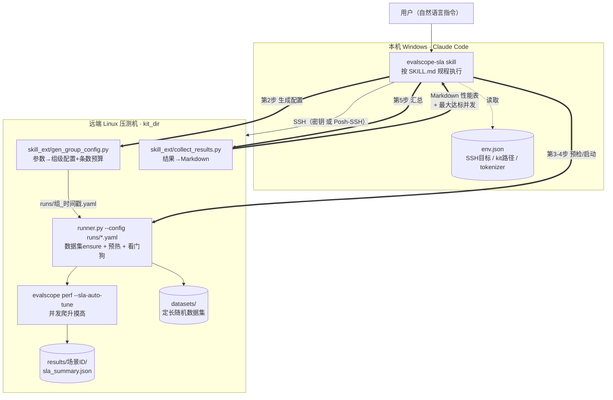
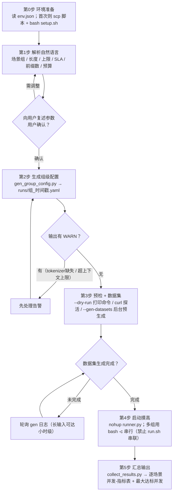
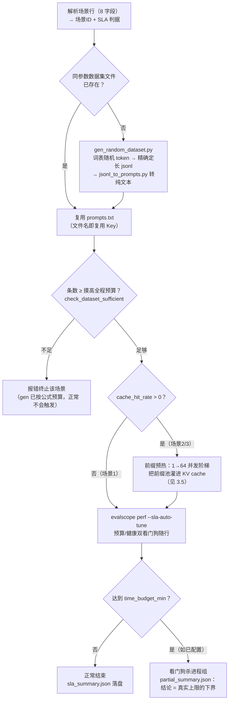
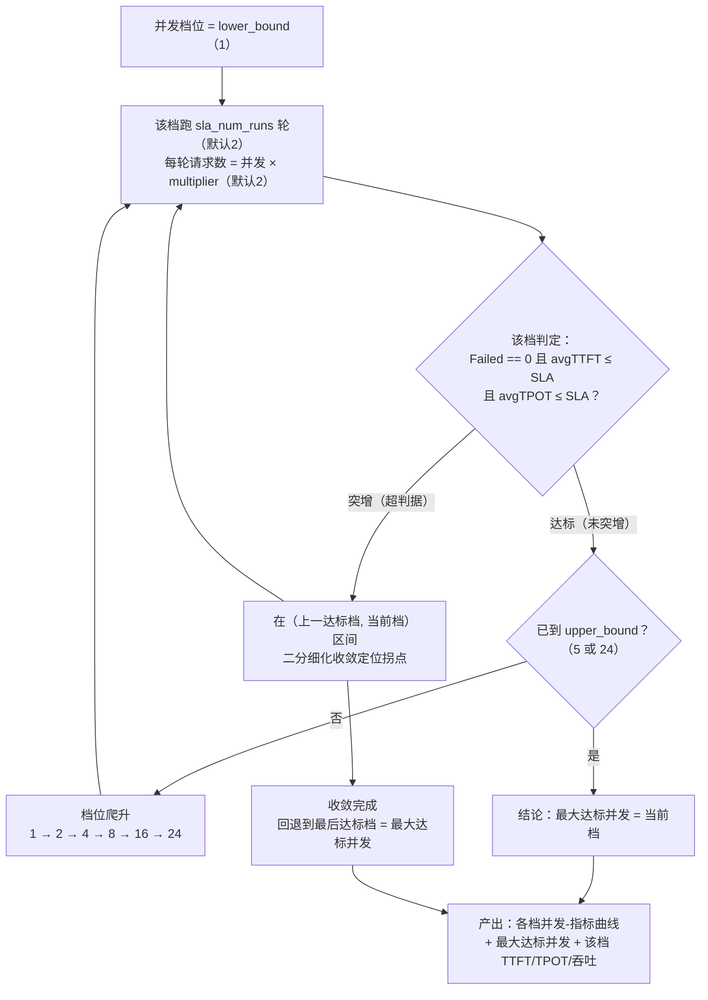
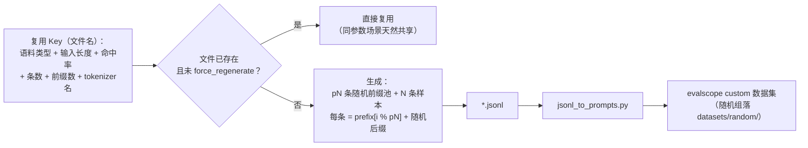
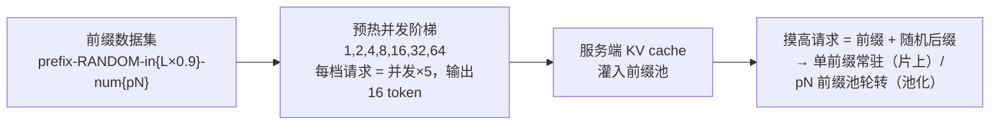
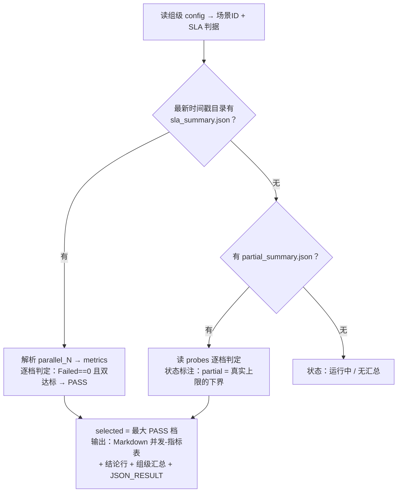
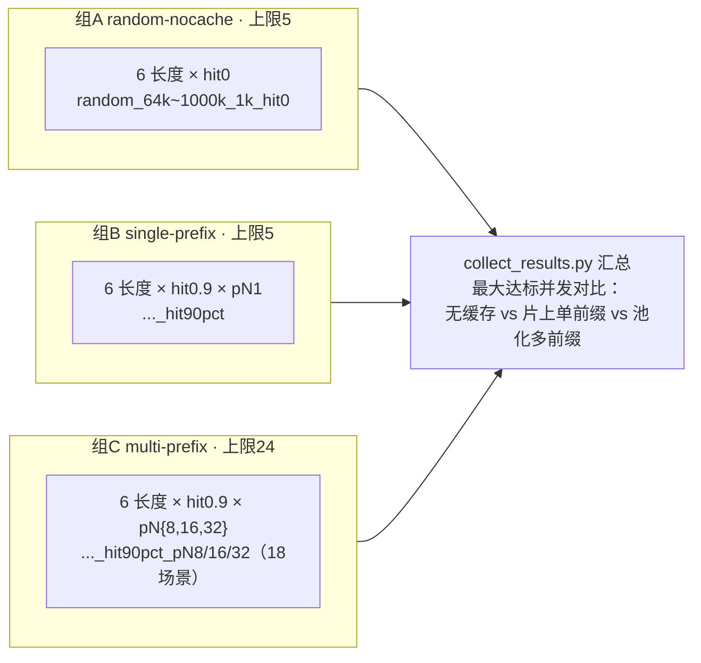

# evalscope-sla — Skill 设计文档

| 项 | 内容 |
|----|------|
| Skill 名称 | `evalscope-sla` |
| 版本 | **v1.4**（2026-11-23，随首次 GitHub 发布） |
| 定位 | 自然语言驱动 evalscope-sla-kit 全部六条测试线的 Claude Code Skill；摸高（性能）线深度封装 |
| 部署位置 | `~/.claude/skills/evalscope-sla/`（分发包：`evalscope-sla-skill-v1.4.zip`） |
| 流程图 | 本文内嵌 **7 幅 Mermaid 流程图**，GitHub / VS Code 直接渲染 |
| 配套文档 | [README.md](README.md)（使用）· [docs/DEVELOPMENT.md](docs/DEVELOPMENT.md)（开发）· [references/](references/)（操作手册） |

---

## 1. 设计思路

### 1.1 要解决的问题

[evalscope-sla-kit](https://github.com/huanghuancai666/evalscope-sla-kit) 是一个推理服务
综合测试台（6 条测试线），其中摸高线回答一个核心问题：**"这个服务在 TTFT/TPOT 不突增
的前提下，最多能扛多少并发？"**。但它本身是工程师工具：要手改 `config.yaml` 场景清单、
按摸高档位预算数据集条数、拼 nohup 命令、盯数小时日志、解析 JSON 结果。

本 skill 把这套流程变成一句自然语言，并内置用户点名的三大场景组默认矩阵：

| # | 需求场景（用户原文） | 摸高上限 | SLA 判据默认 |
|---|---|---|---|
| 1 | 随机数据集测试·无缓存命中（prefix cache 0%），64k/75k/128k/256k/512k/1m 输入+1k 输出 | 5 | TTFT≤60s / TPOT≤50ms |
| 2 | 单前缀头测试·片上缓存命中（单前缀 90%），同长度 | 5 | TTFT≤10s / TPOT≤50ms |
| 3 | 多前缀头测试·池化缓存命中（8/16/32 前缀 90%），同长度 | 24 | TTFT≤10s / TPOT≤50ms |

「并发由低摸高至 TTFT 或 TPOT 突增」= evalscope `--sla-auto-tune`；「突增」= 超 SLA
判据即停并回退。全量默认 30 个场景（6+6+18），完整清单见
[references/scenario-matrix.md](references/scenario-matrix.md)。

### 1.2 设计目标

1. **零手写配置**：自然语言 → 参数 → 自动生成组级 override YAML（含数据集条数预算），不改 kit 基座
2. **工具功能零删改**：kit 六线全保留——摸高线深度封装，其余五线命令直达（见 §2.3）
3. **环境无关**：SSH 驱动远端 Linux 压测机，目标存 `env.json`，随时换机器
4. **长任务可运维**：nohup 后台、组间串行、进度/停止/续跑/排障全套规程
5. **结果自动成表**：各档并发指标 + 最大达标并发结论，直接转述用户

### 1.3 已确认的关键决策

| 决策点 | 结论 | 理由 |
|---|---|---|
| 「5人/24人」语义 | = 摸高并发上限 `sla_upper_bound` | 用户确认；到上限或 SLA 突增先到者停 |
| 「1m 输入」 | 归一为 kit 写法 `1000k` = **1024000** token（非 1048576） | kit `parse_len` 只认 k 简写 |
| 数据集语料 | 三组默认 `random`（随机 token 定长） | 组 1 点名随机；三组同语料横向可比 |
| 配置方式 | 组级 override（`base_config` 挂基座） | kit 深合并原生支持；基座留给其他线/Web 共用 |
| SLA 判据默认 | 0%组 60s/50ms、90%组 10s/50ms | 沿用 kit config 内置示例，可被自然语言覆盖 |

---

## 2. 总体架构

### 2.1 架构图



### 2.2 目录结构（三层）

```
evalscope-sla/
├── SKILL.md                     ← 入口层：NL 解析规则 / 六步流程 / 五线路由 / 交互纪律
├── 设计文档.md                   ← 本文档（含 7 幅流程图）
├── README.md                    ← 使用文档
├── env.example.json             ← → 复制为 env.json（压测机与被测服务信息）
├── references/                  ← 知识层：按需加载
│   ├── kit-overview.md             工具全貌：六条测试线命令手册
│   ├── scenario-matrix.md          三组 30 场景全表 / 时长预估 / 结果结构
│   └── operations.md               进度/停止/重跑/排障表
├── scripts/                     ← 执行层：部署到压测机 kit_dir/skill_ext/
│   ├── gen_group_config.py         参数 → 组级 override YAML（stdlib，末尾输出 JSON_RESULT）
│   └── collect_results.py          sla_summary/partial_summary → Markdown（stdlib+pyyaml）
└── docs/
    └── DEVELOPMENT.md              开发文档（kit 机制详解/脚本内部/扩展指南/冒烟清单）
```

### 2.3 模块职责与封装深度

| 功能 | 封装方式 | 承担模块 |
|---|---|---|
| 摸高线（三大场景组） | **深度封装**：默认矩阵+配置生成+预算+专用汇总 | gen_group_config.py / collect_results.py |
| 精度/功能/AgentX/BFCL/SWE 五线 | 命令直达：NL 路由到 kit 原生入口 | SKILL.md 路由表 + references/kit-overview.md |
| 池对照 / Web 控制台 | 命令直达 + 双驱动防护约定 | 同上 |

---

## 3. 核心流程（流程图）

### 3.1 端到端主流程（SKILL.md 六步）



### 3.2 摸高单场景执行流程（runner.py 内部）



### 3.3 SLA 摸高搜索算法（"由低摸高至突增"的本质）



### 3.4 数据集生成与复用



### 3.5 前缀预热与 90% 命中的形成（场景 2/3 专属）



> 场景 2 与场景 3 的差异全在 `prefix_num`：pN=1 时唯一大前缀常驻片上缓存；
> pN=8/16/32 时前缀池分散、单前缀存在被逐出压力——正是"池化缓存"要测的形态。

### 3.6 结果汇总流程（collect_results.py）



### 3.7 三大场景组全景



---

## 4. 数据与产物

### 4.1 产物生命周期

| 阶段 | 产物 | 位置（压测机 kit_dir） |
|---|---|---|
| 第2步 | 组级配置 | `runs/组_时间戳.yaml`（base_config 挂基座） |
| 第3步 | 定长数据集 | `datasets/random/RANDOM-in*.jsonl` + `.prompts.txt`（按文件名复用） |
| 第3步 | 前缀数据集（90%组） | `datasets/random/prefix-RANDOM-*.jsonl` |
| 第4步 | 前缀预热日志 | `results/场景ID/prefix_warmup/conc*/` |
| 第4步 | 摸高结果 | `results/场景ID/时间戳/model/sla_summary.json`（`parallel_N → metrics/percentiles`） |
| 第4步 | 预算切断 | `results/场景ID/partial_summary.json`（probes + selected=下界） |
| 全程 | 运行日志 | `logs/skill_*.log` / `logs/gen_*.log` |
| 第5步 | 汇总输出 | Markdown（stdout）+ 末尾 `JSON_RESULT:` 行 |

### 4.2 判定语义

- **单档 PASS**：`Failed==0` 且 `avg TTFT≤SLA` 且 `avg TPOT≤SLA`（与 kit report.py / partial_verdict 同口径）
- **最大达标并发**：全部 PASS 档中的最大并发；该档 TTFT/TPOT/吞吐随结论输出
- **无达标档**：最低并发即违反 SLA 或请求失败 → 先按排障表查服务可用性
- **partial**：`time_budget_min` 到限切断，`selected` 是真实上限的**下界**（真实上限落在已达标档与首个违反档之间），转述必须带此语义

---

## 5. 需求 → 场景覆盖矩阵

| 需求原文（用户） | 场景组 | kit 落地 | 场景数 |
|---|---|---|---|
| ①随机数据集·无缓存 0%·64k~1m+1k·5人时 | `random-nocache` | `random` 数据集 hit=0，上限 5 | 6 |
| ②单前缀头·片上缓存 90%·同长度·5人时 | `single-prefix` | hit=0.9 pN=1 + 前缀预热，上限 5 | 6 |
| ③多前缀头·池化缓存 8/16/32·90%·24人时 | `multi-prefix` | hit=0.9 pN=8/16/32，上限 24 | 18 |
| 并发由低摸高至 TTFT/TPOT 突增 | — | `--sla-auto-tune`（§3.3） | — |
| 输出性能数据 | — | collect_results 汇总（§3.6） | — |

---

## 6. 扩展点与已知限制

### 6.1 扩展点

- **新增场景组**：`gen_group_config.py` 的 `GROUPS` 表加一项 → `references/scenario-matrix.md` 补全表 → `SKILL.md` 解析表加触发词
- **新增参数**：argparse 加参 → 写入 YAML → SKILL.md 解析表补行
- **其他五线升级深度封装**：复用"gen 生成器 + collect 解析器 + SKILL 路由"三件套，套路见 [docs/DEVELOPMENT.md](docs/DEVELOPMENT.md) §C.2b

### 6.2 已知限制

| 项 | 说明 | 缓解 |
|---|---|---|
| 脚本未实跑 | 本机无 Python，仅人工逐行核查 | 部署后按 DEVELOPMENT.md §D.1 冒烟清单验证 |
| 长输入耗时/体量 | 1m×280 条 ≈ 1GB+、生成小时级；组 C 全量天级 | 分批跑 + time_budget_min |
| 服务上下文上限 | 256k+ 档需服务真支持 | gen 预检 WARN 拦截 |
| report.py 判据来源 | 只读基座 config，不认组级覆盖 | 汇总以 collect_results.py 为准 |
| web 双驱动 | webapp 看不到 runs/*.yaml | skill 任务一律 CLI 驱动 |
